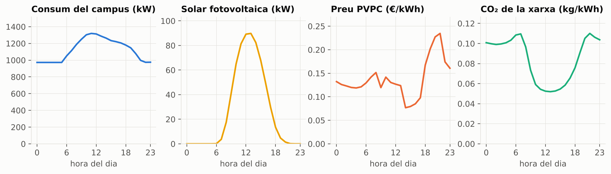
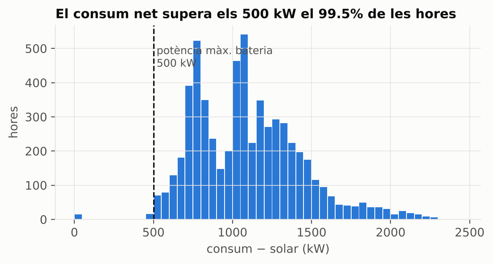
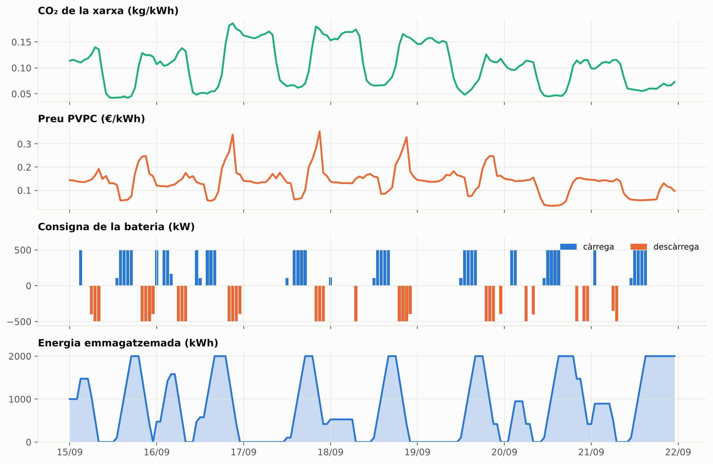
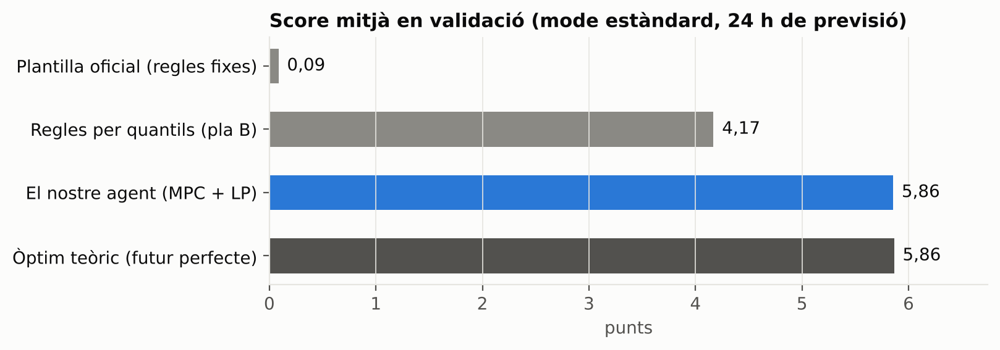
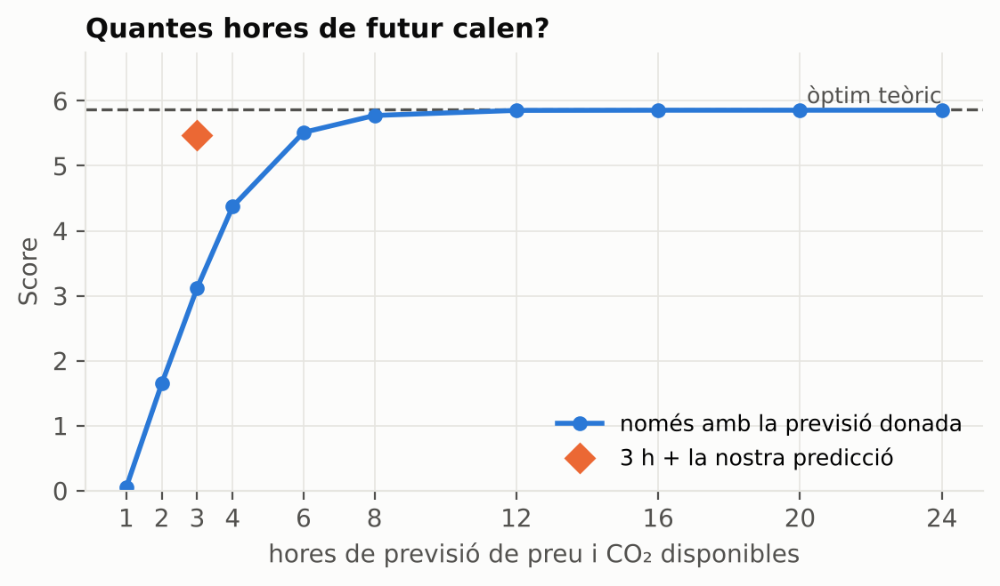
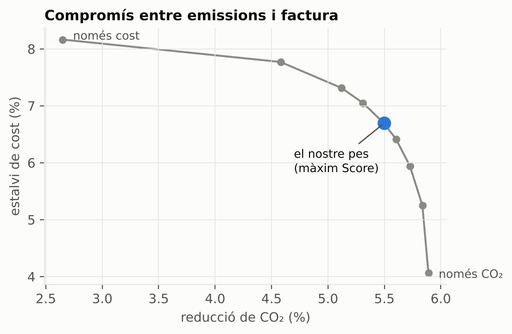

# La bateria que sap quan val la pena

**Repte UPC Sostenible × AED — Datathon 2026.** Agent de control per a la bateria industrial del Campus Nord
(2.000 kWh, ±500 kW, rendiment 90 %), que decideix cada hora si carrega, descarrega o espera per reduir
emissions de CO₂ (70 % del Score) i factura elèctrica (30 %).

| | Score en validació | % de l'òptim teòric | Infraccions |
|---|---|---|---|
| Plantilla oficial (regles fixes) | 0,09 | 1 % | 3–9 |
| Regles per quantils (el nostre pla B) | 4,17 | 71 % | 0 |
| **El nostre agent (MPC + programació lineal)** | **5,86** | **99,8 %** | **0** |
| Òptim teòric amb tot el futur conegut | 5,87 | 100 % | 0 |

Mitjana de tres rèpliques del test fetes amb setmanes reservades del train (detall a [Validació](#4-validació)).
Al rànquing públic oficial l'agent obté **6,43 punts**.

**Mode Difícil** (bateria de 6.000 kWh i ±1.500 kW, solar ×12, només 3 h de previsió): agent propi a
[`submission_dificil/`](submission_dificil/), amb **18,9 punts** en validació sobre un òptim teòric de 21,3
(detall a [Mode Difícil](#7-mode-difícil)).

## Què s'ha de lliurar

| Fitxer | Què és |
|---|---|
| [`submission.zip`](submission.zip) | **El lliurament del mode estàndard.** Conté `agent.py`, `params.json` i dos models de previsió de mercat. |
| [`submission_dificil.zip`](submission_dificil.zip) | **El lliurament del Mode Difícil** (rànquing independent). Conté el seu `agent.py`, `params.json` i quatre models. |
| [`submission/agent.py`](submission/agent.py) | El codi de l'agent, comentat. També es pot pujar sol (funciona sense els fitxers auxiliars; vegeu més avall). |
| Aquesta memòria i [`docs/GUIA_PRESENTACIO.md`](docs/GUIA_PRESENTACIO.md) | Raonament tècnic i guió de la presentació. |

## 1. Què diuen les dades

Hem agregat la telemetria de 5 minuts a hores amb la mateixa recepta del tutorial oficial, perquè `load_kw` i `pv_kw`
coincideixin amb els del simulador (`src/prepare_data.py`): **5.993 hores**, de setembre de 2025 a agost de 2026.
El train no té cap hora de novembre.



- **CO₂ de la xarxa:** mínim al migdia (solar peninsular), màxim al matí i a la nit.
- **Preu PVPC:** vall de 14 a 17 h i punta molt marcada de 19 a 22 h. La correlació amb el CO₂ és 0,58: s'assemblen, però no són el mateix senyal.
- **Solar pròpia:** petita. Pic de 144 kW davant d'un consum mitjà de 1.120 kW; mai hi ha excedents.

### La troballa que simplifica el problema



El consum net (consum − solar) supera els 500 kW de la bateria el **99,5 % de les hores**. Per tant, tot el que es
descarrega substitueix energia de xarxa i **no cal predir el consum ni la solar**: només cal triar bé les hores, i el
preu i el CO₂ ja es coneixen amb 24 h d'antelació.

L'única excepció són les caigudes de telemetria (15 hores amb consum = 0 al train). Allà el campus «no importa res»
segons el simulador, de manera que descarregar no estalvia res. L'agent les detecta amb l'última lectura i no hi descarrega.

## 2. L'estratègia

### Dos objectius, un sol senyal

El Score és `0,70·ΔCO₂(%) + 0,30·ΔCost(%)`, i tots dos termes són lineals en l'energia importada a cada hora.
Maximitzar-lo equival exactament a minimitzar `Σ xarxa_t · w_t` amb

```
w_t = co2_t + κ · preu_t          κ = (0,30 / 0,70) · (CO₂ base / Cost base) = 0,2517 kg/€
```

κ es calcula amb les dades de train (`src/fit_params.py`); no és un hiperparàmetre ajustat a mà.

### Control predictiu amb programació lineal

A cada hora l'agent:

1. **Observa** l'estat de càrrega i el preu i CO₂ de les properes 24 h, i els fon en `w`.
2. **Optimitza**: resol un programa lineal (scipy/HiGHS) amb la física exacta de l'enunciat — rendiment √0,9 per
   sentit, ±500 kW, 0–2.000 kWh i el balanç al punt de connexió (descarregar per sobre del consum només val els
   0,04 €/kWh de compensació d'excedents).
3. **Actua**: aplica només la consigna de la primera hora, passada per un *clamp* que garanteix 0 infraccions.
4. **Repeteix** a l'hora següent amb la informació nova.

No hi ha llindars a ull ni caixes negres: cada consigna és la solució d'un problema que es pot auditar.



El patró (carregar a la vall solar, descarregar a la punta del vespre i, si compensa, al matí) no està programat:
surt de l'optimització. De mitjana fa 1,4 cicles al dia.

### Si només hi hagués 3 h de previsió

L'agent estàndard detecta la longitud del vector de previsió. Amb només 3 h, l'estén fins a 24 h amb dos models
LightGBM (CO₂ i preu; `src/train_forecaster.py`). És l'experiment de la figura «Quantes hores de futur calen?»;
el Mode Difícil de la plataforma és un problema diferent i té el seu propi agent ([secció 7](#7-mode-difícil)).

## 3. Robustesa

- **0 infraccions per construcció.** El *clamp* final fa servir el rendiment exacte `0.9 ** 0.5` i un marge de 1e-4
  (la plantilla oficial arrodoneix a 0,9487 i per això comet infraccions).
- **Pla B dins del mateix agent.** Si scipy o els models fallessin, o el temps acumulat passés de 40 s, l'agent canvia
  a una regla per quantils que ja obté 4,17 punts.
- **Temps:** unes 2.000 decisions en ~6 s (límit: 60 s).
- **Casos límit coberts:** salt entre setmanes de mesos diferents (es buida la memòria), final de la simulació (el
  vector de previsió s'escurça i l'agent buida la bateria, perquè l'energia que hi quedi no puntua), vectors buits,
  timestamp absent o en text, i vector de previsió que no comenci per l'hora actual.

## 4. Validació

El test ocult són els últims 7 dies de cada mes. L'hem imitat tres vegades amb dies del train (1–7, 8–14 i 15–21 de
cada mes, concatenats com fa el servidor). Per a cada rèplica, **tots** els paràmetres i models s'aprenen només amb
la resta de dies, i s'avalua amb el simulador oficial amb les regles de la web (0,20 punts per infracció, excedents a
0,04 €/kWh). Tot surt de `src/evaluate.py` → `docs/results.json`.

| Rèplica (dies) | Òptim teòric | El nostre agent | ΔCO₂ | ΔCost | Amb només 3 h de previsió |
|---|---|---|---|---|---|
| 1–7 | 6,089 | 6,085 | 5,67 % | 7,05 % | 5,680 |
| 8–14 | 5,929 | 5,929 | 5,64 % | 6,60 % | 5,579 |
| 15–21 | 5,576 | 5,553 | 5,18 % | 6,43 % | 5,162 |
| **Mitjana** | **5,865** | **5,856** | **5,50 %** | **6,69 %** | **5,474** |



L'**òptim teòric** és un programa lineal sobre tot el període amb coneixement perfecte del futur (`core.oracle`): cap
agent el pot superar. Ens en separen 0,01 punts, i gairebé tota la diferència ve de la rèplica 15–21, que conté una
caiguda de telemetria de 14 hores impossible de preveure.

Conseqüència pràctica: **el Score d'aquest repte té un sostre físic** (el que dona la bateria), i l'hem assolit.

### Quanta informació cal?



Hem repetit la simulació donant a l'agent des d'1 fins a 24 hores de previsió. A partir de 12 h el Score és pla: la
bateria s'omple en 4 h i es buida cada dia, i saber més enllà no canvia cap decisió. Per això planificar a 36 o 48 h
amb previsions pròpies no aporta res (ho hem provat: mateix resultat fins al quart decimal). Si només hi hagués 3 h
de previsió sí que caldria predir: sense predicció el Score cau a 3,12; amb perfils horaris puja a 5,22 i amb
LightGBM a 5,47.

### Sensibilitat al pes del preu



| Pes del preu | ΔCO₂ | ΔCost | Score |
|---|---|---|---|
| 0 (només CO₂) | 5,89 % | 4,07 % | 5,34 |
| 0,75·κ | 5,60 % | 6,41 % | 5,84 |
| **κ (el nostre)** | **5,50 %** | **6,69 %** | **5,86** |
| 1,5·κ | 5,31 % | 7,05 % | 5,83 |
| ∞ (només cost) | 2,65 % | 8,16 % | 4,31 |

El κ de la fórmula és el màxim de Score a les tres rèpliques, i la corba és plana al seu voltant: si al test la
relació CO₂/cost fos una mica diferent, el resultat gairebé no canviaria.

## 5. Impacte i límits

Extrapolant les 5.417 hores de validació a un any: unes **44 t de CO₂** evitades (sobre ~810 t) i uns **91.000 €**
d'estalvi (sobre ~1,36 M€), amb uns **500 cicles l'any**.

Límits que cal dir clarament:

- Els resultats són de validació amb dades de train; el Score real és el del test ocult de la plataforma. Al rànquing públic (el 50 % de cada setmana de test) l'agent obté **6,43 punts amb 0 infraccions**.
- La web dona dos valors per a la compensació d'excedents (0,04 €/kWh a les bases i 0 € a les preguntes freqüents). No afecta el resultat: el campus consumeix gairebé sempre més de 500 kW i l'agent no aboca energia a la xarxa.
- El repte no modela la degradació ni el cost de la bateria. 500 cicles l'any escurcen la vida útil; el mateix
  programa lineal admet un cost per cicle afegint un terme a l'objectiu, i serviria per decidir la inversió i la mida òptima.
- La bateria mou al voltant del 10 % de l'energia diària del campus: l'impacte té sostre.
- El train no conté novembre; l'agent no depèn de patrons mensuals en mode estàndard, i en Mode Difícil el model
  rep el mes com una variable més.

## 6. Com reproduir-ho

```bash
pip install -r requirements.txt
```

```bash
python src/prepare_data.py <carpeta data/train del paquet oficial>
```

```bash
cd src && python fit_params.py && python train_forecaster.py && python evaluate.py && python make_figures.py && python make_submission.py
```

```bash
python starter_kit/check_submission.py submission.zip
```

| Fitxer | Funció |
|---|---|
| `src/prepare_data.py` | Telemetria de 5 min → taula horària (`data/processed/campus_hourly.csv`, inclosa al repositori) |
| `src/core.py` | Simulador oficial amb les regles de la web, Score exacte i òptim teòric |
| `src/fit_params.py` | κ i perfils horaris → `submission/params.json` |
| `src/train_forecaster.py` | Models del Mode Difícil → `submission/forecaster_*.txt` |
| `src/evaluate.py` | Validació creuada completa → `docs/results.json` |
| `src/make_figures.py` | Figures de `docs/figures/` |
| `src/make_submission.py` | Empaqueta `submission.zip` |
| `src/hard_core.py`, `src/hard_train.py`, `src/hard_eval.py` | Mode Difícil: simulador i òptim teòric, entrenament dels quatre models, validació |
| `starter_kit/` | Simulador, validador i plantilla oficials (sense modificar; la plantilla és `agent_baseline.py`) |

## 7. Mode Difícil

Rànquing independent amb una infraestructura ampliada: bateria de **6.000 kWh i ±1.500 kW**, planta solar **×12**
(fins a ~1.650 kW), només **3 hores** de previsió de preu i CO₂, i excedents a 0 €. És un problema diferent del
mode estàndard, i per això té un agent propi (`submission_dificil/agent.py`).

**Què canvia de fons.** Al mode estàndard no calia predir el consum; aquí és el centre del problema:

- La bateria pot donar 1.500 kW, però el consum net sol ser de 600–1.300 kW: tot el que es descarrega de més es perd.
- El 9 % de les hores la solar supera el consum: aquest excedent carrega la bateria gratis (0 € i 0 kg de CO₂).
- El mercat només es coneix a 3 hores; la resta del dia s'ha de predir.

**Com ho resolem.**

1. **Quatre models LightGBM** (`src/hard_train.py`) prediuen hora a hora fins a +23 h el CO₂, el preu, el consum
   i la solar. Fan servir l'hora, el dia, el mes, la meteorologia de l'última hora i la memòria de l'agent
   (última hora, ahir a la mateixa hora, envolupant de cel clar). En entrenar s'emmascara la memòria imitant el
   test, on cada setmana comença sense historial.
2. **Escenaris d'incertesa.** L'error de predicció del consum net es mesura fora de mostra i es converteix en
   7 escenaris per hora (quantils), segons l'antelació i el nivell de solar previst.
3. **Programa lineal estocàstic.** Es minimitza el valor esperat de `Σ xarxa · w`, calculant la importació
   escenari a escenari. Així el pla ja descompta que descarregar de més es perd i que carregar amb excedent és gratis.
4. Mateix esquema MPC (només s'aplica la primera hora), mateix *clamp* de seguretat i política de reserva.

**Resultats en validació** (`src/hard_eval.py` → `docs/results_dificil.json`; mateixes tres rèpliques):

| Rèplica (dies) | Òptim teòric | Agent estàndard sense adaptar | Predicció puntual | **Amb escenaris** | ΔCO₂ | ΔCost |
|---|---|---|---|---|---|---|
| 1–7 | 22,44 | 8,17 | 18,17 | **19,54** | 18,5 % | 22,0 % |
| 8–14 | 21,42 | 7,91 | 18,91 | **19,31** | 18,7 % | 20,7 % |
| 15–21 | 19,92 | 7,21 | 17,31 | **17,78** | 16,9 % | 19,8 % |
| **Mitjana** | **21,26** | **7,76** | **18,13** | **18,88** | | |

0 infraccions a totes les rèpliques i uns 12 s per a 2.000 hores.

**On és el marge que queda.** Amb previsió perfecta del mercat l'agent guanyaria ~1,0 punt, i amb previsió
perfecta de consum i solar ~0,9 (mesurat a la rèplica 15–21). És incertesa del temps i del mercat que les dades
disponibles no permeten reduir gaire: hem provat models més grans i més variables, i l'error de predicció millora
menys d'un 1 %. Tractar la incertesa amb escenaris, en canvi, dona +0,75 punts sobre la predicció puntual.

Els valors són de validació amb setmanes del train; el Score del test ocult pot ser diferent perquè les setmanes
(i la seva solar) són unes altres.
